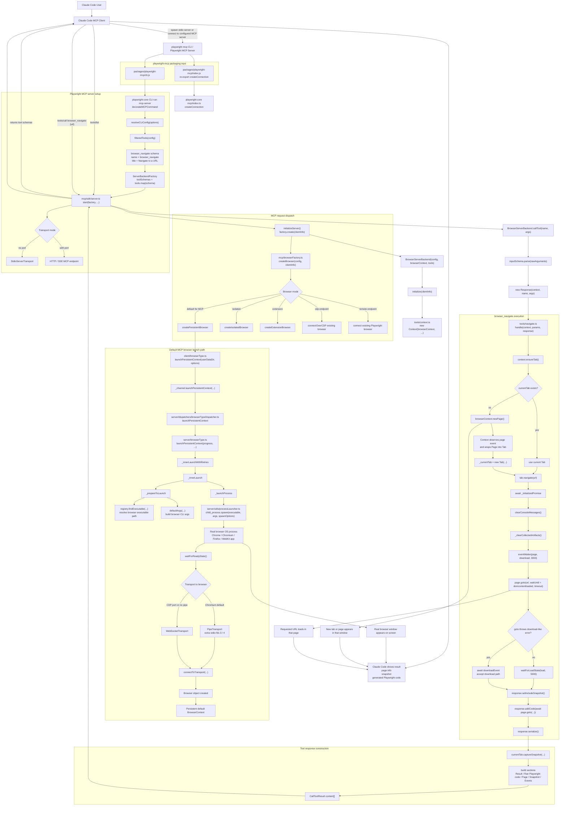

# Playwright

[https://github.com/microsoft/playwright](https://github.com/microsoft/playwright)

## Playwright 是什么

Playwright 是一个用于 **Web 测试**和浏览器自动化的综合框架，能够对现代 Web 应用进行可靠、快速且跨浏览器的**测试**。由 Microsoft 构建，它提供了**统一的 API，可以通过单一代码库自动化操作 Chromium**、Firefox 和 WebKit 浏览器，支持 Node.js、Python、.NET 和 Java 语言。

## 核心能力

| 能力项 | 描述 | 主要 API/包 |
| --- | --- | --- |
| **浏览器自动化** | **启动/连接浏览器、导航页面、与元素交互** | **playwright-core, playwright** |
| 端到端测试 | 具备测试夹具、并行化、分片和重试功能的测试运行器 | @playwright/test |
| 网络拦截 | 拦截、修改、模拟 HTTP 和 WebSocket 流量 | Page.route、BrowserContext.route、Page.routeWebSocket |
| API 测试 | 在浏览器外发送共享 Cookie 的 HTTP 请求 | APIRequestContext |
| 组件测试 | 通过 Vite 独立挂载和测试 UI 组件 | @playwright/experimental-ct-\* |
| **代码生成** | **记录用户操作并生成测试代码** | **playwright codegen** |
| 追踪记录 | 捕获完整的执行轨迹（DOM 快照、网络、控制台） | BrowserContext.tracing, playwright show-trace |
| UI 模式 | 支持实时轨迹显示的交互式测试开发 | playwright test --ui |
| MCP 服务器 | 用于 AI 代理集成的浏览器自动化服务器 | packages/playwright/lib/mcp/ |

# Playwright MCP

## Playwright MCP 是什么

Playwright MCP 是一个 MCP 服务器，LLM 通过它和网页交互，而且重点不是依赖识别截图，而是基于 **structured accessibility snapshots**。优点：

- 更适合 agent 调用
- 比纯视觉点按更可控
- 更接近“结构化网页操作”而不是“图像识别

## Claude Code 使用 Playwright MCP

### 安装

它是 claude code 官方的 MCP 插件

```txt
/plugin 安装
```


可以通过 `/mcp list` 进行查看


## 核心能力

内置了 22 个工具


| 工具技能 | 含义 | 具体实现 |
| --- | --- | --- |
| Close browser | 关闭浏览器 |  |
| Resize browser window | 调整浏览器窗口 |  |
| Get console messages | 获取控制台输出信息 |  |
| **Handle a dialog** | **处理对话框** |  |
| **Evaluate JavaScript** | **执行 JS 脚本** |  |
| Upload files | 上传文件 |  |
| **Fill form** | **填写表格** |  |
| Install the browser specified in the config | 安装配置中指定的浏览器 |  |
| **Press a key** | **按任意键** |  |
| **Type text** | **输入文本** |  |
| **Navigate to a URL** | **导航到特定 URL 地址** |  |
| **Go back** | **返回** |  |
| List network requests | 列出网络请求 |  |
| Run Playwright code | 执行 Playwright 代码 |  |
| **Take a screenshot** | **截图** |  |
| Page snapshot | 保存页面的HTML结构、CSS和内容 |  |
| **Click** | **点击** |  |
| Drag mouse | 拖动鼠标 |  |
| Hover mouse | 悬停鼠标 |  |
| Select option | 选择选项 |  |
| Manage tabs | 管理标签页 |  |
| Wait for | 等待 |  |

## Demo 操作流程

```txt
帮我打开这个网址 http://43.160.215.35:8317/management.html，在左边侧边栏找到配置面板，在配置面板找到API 密钥列表，在 API 密钥列表添加一个新生成的API密钥
```


```sql
刚才在执行任务的过程中你看到了什么，做了什么，调用了什么工具，怎么调用的                                                                                                                  
                                                                           
⏺ 你这个问题很好，我按 “看到什么 / 做了什么 / 调用了什么工具 / 怎么调用” 给你完整复盘：                                                                                                     
                                                                                                                                                                                            
  1) 我看到了什么                                                                                                                                                                           
                                                                                                                                                                                            
  - 你给的网址打开后，页面自动跳到登录路由：#/login                                                                                                                                         
  - 页面标题：CLI Proxy API Management Center                                                                                                                                               
  - 登录页有：
    - 管理密钥 输入框
    - 登录 按钮
  - 登录后进入主界面（#/），左侧栏能看到：
    - 配置面板
  - 进入配置面板（#/config）后看到：
    - API 密钥列表 (api-keys)
    - 添加 API 密钥 按钮
  - 添加弹窗里看到：
    - API 密钥 输入框
    - 生成 按钮
    - 添加 按钮
  - 保存时出现 确认变更 弹窗（显示 config.yaml diff）
  - 最后页面提示：配置已保存

  ---
  2) 我做了什么

  按顺序执行了这些操作：

  1. 打开你给的 URL
  2. 发现需要管理密钥登录，向你要密钥
  3. 用你给的密钥填入登录框并点击登录
  4. 点击左侧栏 配置面板
  5. 在 API 密钥列表 点击 添加 API 密钥
  6. 在弹窗点击 生成，生成了一个新密钥
  7. 点击 添加 把密钥加入列表
  8. 点击底部 保存
  9. 在确认弹窗点击 确认保存
  10. 收到“配置已保存”提示，完成任务

  ---
  3) 我调用了什么工具

  这次只用了 Playwright MCP 工具（浏览器自动化），没有改本地代码、没有 Bash、没有文件编辑。

  具体工具类型：

  - browser_navigate：打开网页
  - browser_fill_form：填表（管理密钥）
  - browser_click：点击按钮/菜单（登录、配置面板、添加、保存、确认保存）

  ---
  4) 怎么调用的（调用方式）

  每次调用都传结构化参数，大致像这样：

  - 打开网页
    - browser_navigate({ url: "http://43.160.215.35:8317/management.html" })
  - 填管理密钥
    - browser_fill_form({ fields: [{ ref: "e35", type: "textbox", value: "123456" }] })
  - 点击登录
    - browser_click({ ref: "e46", button: "left" })
  - 点击配置面板
    - browser_click({ ref: "e110", button: "left" })
  - 点击添加 API 密钥
    - browser_click({ ref: "e307", button: "left" })
  - 点击生成
    - browser_click({ ref: "e485", button: "left" })
  - 点击添加
    - browser_click({ ref: "e491", button: "left" })
  - 点击保存
    - browser_click({ ref: "e469", button: "left" })
  - 点击确认保存
    - browser_click({ ref: "e583", button: "left" })

  其中 ref 是页面快照里元素的内部定位引用（如 e35/e46 等），由 Playwright 快照返回后我再拿来点击或输入。
```

## 具体实现拆解

### 工具

```ts
export type Tool<Input extends z.Schema = z.Schema> = {
  capability: ToolCapability; # 工具能力
  skillOnly?: boolean;
  schema: ToolSchema<Input>;
  handle: (context: Context, params: z.output<Input>, response: Response) => Promise<void>;
};
```

- ToolCapability：工具的能力
- schema

### **Navigate to a URL**

#### 工具定义

```javascript
const navigate = defineTool({
  // 工具的能力类型
  capability: 'core-navigation', 
  
  // 对外展示的信息，比如说给模型看的
  schema: {
    name: 'browser_navigate',
    title: 'Navigate to a URL',
    description: 'Navigate to a URL',
    // 这个工具接收什么参数
    inputSchema: z.object({
      url: z.string().describe('The URL to navigate to'),
    }),
    type: 'action', // 这是一个“执行动作”的工具，而不是只读查询类工具。
  },
  
  // 工具被调用时实际运行的代码
  handle: async (context, params, response) => {
    // 确保当前有可用的标签页，没有的话就创建/拿到一个。
    const tab = await context.ensureTab();
    let url = params.url;
    try {
      new URL(url);
    } catch (e) {
      if (url.startsWith('localhost'))
        url = 'http://' + url;
      else
        url = 'https://' + url;
    }
    // 导航到对应 URL
    await tab.navigate(url);
    // 让响应里包含页面快照
    response.setIncludeSnapshot();
    response.addCode(`await page.goto('${url}');`);
  },
});
```

#### 创建浏览器新窗口

```javascript
async ensureTab(): Promise<Tab> {
const browserContext = await this.ensureBrowserContext();
if (!this._currentTab)
  // 如果当前没有新的 Tab 页就会创建一个新的浏览器
  await browserContext.newPage();
return this._currentTab!;
}

# browserContext 是哪里来的呢
# 在默认模式下 MCP server 启动时基于工厂模式创建一个持久浏览器上下文，包括真实浏览器进程
async function createPersistentBrowser(config: FullConfig, clientInfo: ClientInfo): Promise<playwright.Browser> {
...

    const browserContext = await browserType.launchPersistentContext(userDataDir, launchOptions);
    return browserContext.browser()!;

...
}

```

#### 导航到特定 URL

```ts
async navigate(url: string) {
    await this._initializedPromise;
    
    await this.clearConsoleMessages();
    this._clearCollectedArtifacts();

    const { promise: downloadEvent, abort: abortDownloadEvent } = eventWaiter(this.page, 'download', 3000);
    try {
      await this.page.goto(url, { waitUntil: 'domcontentloaded', ...this.navigationTimeoutOptions });
      abortDownloadEvent();
    } catch (_e) {
      ...
      const mightBeDownload =
        e.message.includes('net::ERR_ABORTED')
        || e.message.includes('Download is starting');
      if (!mightBeDownload)
        throw e;
      ...
      return;
    }

    await this.waitForLoadState('load', { timeout: 5000 });
  }
```

1. 在 MCP 服务器启动时调用 launchPersistentContext(...)，启动真实浏览器进程 browserContext
2. 在调用 ensureTab 时 通过 browserContext.newPage() ，在浏览器上下文里开一个新tab页面
3. 在调用 navigate 时通过 page.goto(url) 导航到目标 URL

#### 创建浏览器进程

1. 直接找到本机浏览器可执行文件
2. 用 Node.js 的 child\_process.spawn(...) 启动浏览器进程（本机的浏览器可执行程序）
3. 给浏览器传一组启动参数（用户是谁、是否使用扩展等等）
4. 再通过 Playwright 自己的协议通道连接这个浏览器
   1. Chromium 通常走 pipe 或 CDP websocket

```ts
/*
launchPersistentContext
  → _innerLaunchWithRetries(...)
  → _innerLaunch(...)
  → _launchProcess(...)
  → launchProcess(...)
  → child_process.spawn(...)
*/

// 客户端代码
 async launchPersistentContext(... ... ): Promise<BrowserContext> {
    ......
    // 启动参数
    const persistentParams: channels.BrowserTypeLaunchPersistentContextParams = {
      ...
    };
    
    const context = await this._wrapApiCall(async () => {
      // 调用服务器端创建
      const result = await this._channel.launchPersistentContext(persistentParams);
      const browser = Browser.from(result.browser);
      browser._connectToBrowserType(this, options, logger, userDataDir);
      const context = BrowserContext.from(result.context);
      await context._initializeHarFromOptions(options.recordHar);
      return context;
    });
    await this._instrumentation.runAfterCreateBrowserContext(context);
    return context;
  }
  
// 服务器端代码
async launchPersistentContext(... ...): Promise<BrowserContext> {
    ... ...
    try {
      const browser = await this._innerLaunchWithRetries(progress, launchOptions, options, helper.debugProtocolLogger(), userDataDir).catch(e => { throw this._rewriteStartupLog(e); });
     
      return browser._defaultContext!;
    } catch (error) {
      await clientCertificatesProxy?.close().catch(() => {});
      throw error;
    }
  }
  
private async _innerLaunchWithRetries(... ...): Promise<Browser> {
    try {
    // 这里会找用哪个浏览器
    const prepared = await progress.race(this._prepareToLaunch(options, isPersistent, userDataDir));
      return await this._innerLaunch(progress, options, persistent, protocolLogger, userDataDir);
    } catch (error) {
    }
  }
  
private async _innerLaunch() {
    const { browserProcess, userDataDir, artifactsDir, transport } = await this._launchProcess(progress, options, !!persistent, browserLogsCollector, maybeUserDataDir);
}

private async _launchProcess() {
    const { launchedProcess, gracefullyClose, kill } = await launchProcess({
      ... ...
}

export async function launchProcess(options: LaunchProcessOptions): Promise<LaunchResult> {
    const spawnedProcess = childProcess.spawn(options.command, options.args || [], spawnOptions);
}

// 跟浏览器建立通信
if (options.cdpPort !== undefined || !this.supportsPipeTransport()) {
        transport = await WebSocketTransport.connect(progress, wsEndpoint!);
      } else {
        const stdio = launchedProcess.stdio as unknown as [NodeJS.ReadableStream, NodeJS.WritableStream, NodeJS.WritableStream, NodeJS.WritableStream, NodeJS.ReadableStream];
        transport = new PipeTransport(stdio[3], stdio[4]);
      }
```


